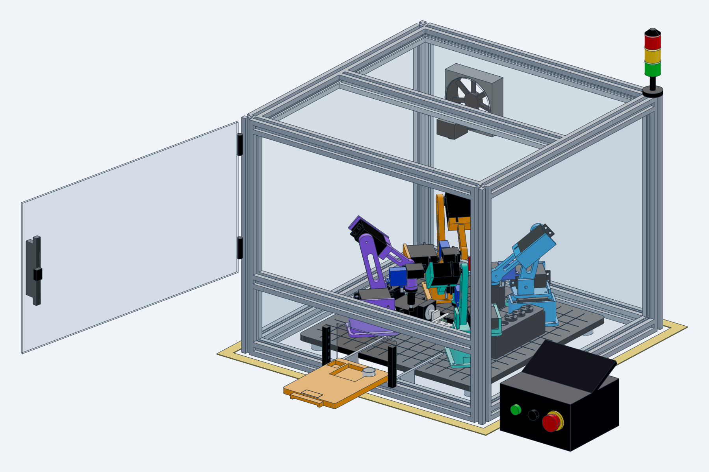
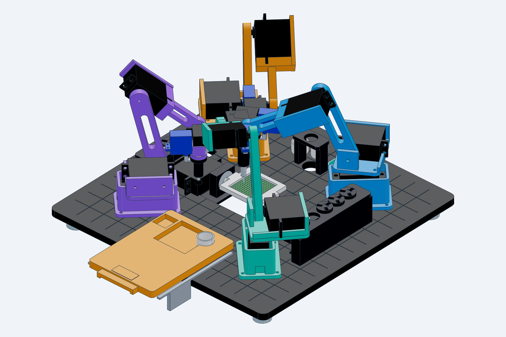

# Forge Mini in CAD

Parametric CAD of the whole miniature cell: four 4-DOF servo arms with tool changers, the eleven tools, the racks, the bit block, the flip fixture with the smartwatch board in it, the work plate, the kit drawer, trays, and the enclosure with its safety gear. It is built with [text-to-cad](https://github.com/earthtojake/text-to-cad) (cadgen 0.7.26, build123d / OpenCascade). Every dimension comes from `controller/cell.yaml`, so the CAD, the planner and the simulator describe the same machine.



| Open this | What it is |
|---|---|
| `STEP/cell.step` | The whole cell, built at the planner's park pose. It has sliders for all 16 arm joints plus the flip fixture, door and kit drawer, and poses `park`, `ready`, `solder_underside`, `pick_parts` and `loading`. |
| `STEP/arm.step` | One arm with the gripper, in the ready pose. Poses: `ready`, `reach_low`, `reach_left`, `park`. |
| `STL/` | Print-ready meshes: the six arm parts, nine tools, racks, bit block, flip base and cradle, kit drawer. |
| `STEP/` | Every part and sub-assembly as STEP, for any CAD program. |

The `.step.json` files beside some STEP files hold the joints and poses. The CAD Viewer (`cadgen viewer`) reads them, so you can drag the arms around.



## Joint sliders

Slider values are **joint angle minus the pose the model was built in**, using the planner's conventions:

- base: + is counter-clockwise from above.
- shoulder: angle above horizontal.
- elbow and wrist: + raises.

`cell.step` is built at park (`[0, 103.2, -142.7, -50.5]`), and `arm.step` at ready (`[0, 90, -90, -90]`). The `solder_underside` and `pick_parts` poses use angles from the planner's own IK (`forge ik`).

## Printed parts per arm

| Part | STL | Holds |
|---|---|---|
| Pedestal | `STL/arm/pedestal.stl` | base MG996R, 4 × M3 to the plate |
| Turntable | `STL/arm/turntable.stl` | sits on the base servo horn |
| Shoulder bracket | `STL/arm/shoulder_bracket.stl` | shoulder MG996R, idler pin |
| Upper arm (L1 = 80) | `STL/arm/upper_arm.stl` | horn pockets for shoulder and elbow |
| Forearm (L2 = 80) | `STL/arm/forearm.stl` | cradles the elbow MG996R; wrist MG90S horn |
| Wrist hub | `STL/arm/wrist_hub.stl` | arm half of the tool changer: ball seats, pogo bores, latch SG90 |

Print four of each, plus one of each tool and one each of the racks, the bit block, the flip base, the flip cradle and the kit drawer.

## Rebuild and check

```
cd forge-mini/cad
uvx --from cadgen==0.7.26 python src/cell.py          # rebuilds whatever changed
uvx --from cadgen==0.7.26 python checks/interference.py
python checks/check_dims.py                           # dims.py vs controller/cell.yaml
```

Sizes live in `src/lib/dims.py`. Change them there, together with `cell.yaml`, and `check_dims.py` will catch any drift between the two. `checks/interference.py` loads the saved cell. It reports any two parts that overlap by more than 1 mm³ and checks that each mounted tool's tip is where the planner expects at park. Current result: 146 parts, 0 overlaps, and all four tool tips match to 0.01 mm.

## Choices and assumptions

- **Servos are datasheet-sized stand-ins** (body, mounting flange with holes, output boss and spline) for the MG996R, MG90S and SG90. The step.parts catalog couldn't be reached from the build machine. Swap in vendor STEP files with `read_step` if you have them.
- **Tool-changer plates are 17.4 mm across, not 20 mm.** The racks space slots 18 mm apart, so 20 mm plates would overlap their neighbours. Tool bodies stay inside 15 mm (11 × 8 mm for the gripper and clamp), and the rack holes are 15 mm. The planner's 20 mm clearance is unchanged and still covers two plate radii.
- **Hanging tools reach below the plate top** (the iron tip sits at z = −12 when racked). The work plate therefore has a slot under each rack and a hole under the iron stand, and it stands on 14 mm feet.
- **The flip cradle sweeps below the plate** (radius 25.5 mm about z = 10). It sits in a window in the plate, with its base frame in a 3 mm rebate underneath.
- **Not modelled:** wiring, the USB-C programming dock slide, the stripper bar on the bit block, and screws.
- Interference is checked only at the saved park pose. The other poses are checked by eye in renders.
